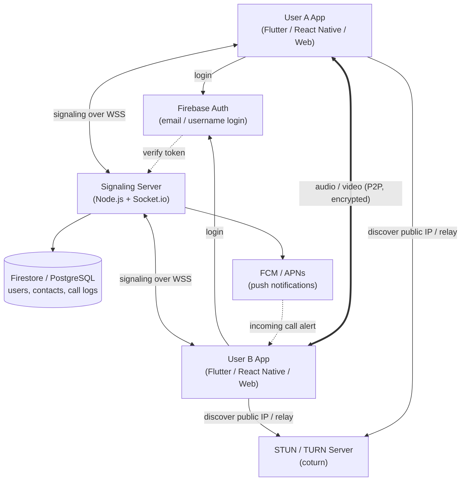
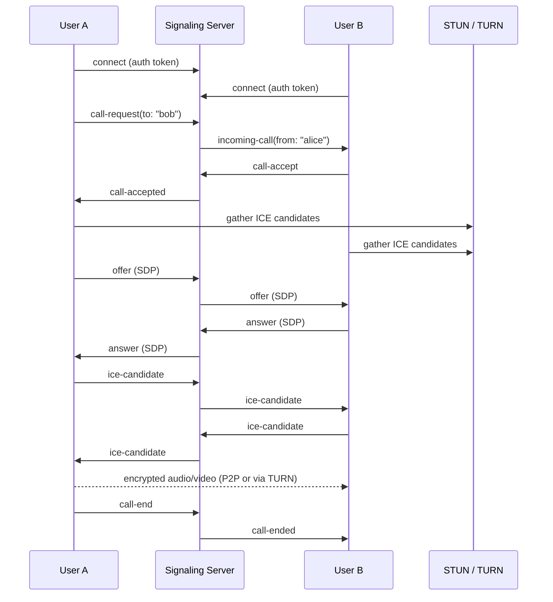

# WebRTC Calling App: Project Document

This document has three parts:

1. [PRD (Product Requirements Document)](#part-1-prd)
2. [Architecture](#part-2-architecture)
3. [Design (UI, data, API, security)](#part-3-design)

---

# Part 1: PRD

## 1.1 Overview

**Product name (working title):** CallMe (placeholder)

**One-line summary:** A mobile and web app that lets people make free voice (and optionally video) calls over WiFi or mobile data, using a username or user ID instead of a phone number.

## 1.2 Problem Statement

- Most calling apps require a phone number to sign up, which creates privacy concerns and ties the account to a SIM.
- People sometimes want to call without sharing their real number.
- Normal calls cost money; internet calls over WiFi are effectively free.

## 1.3 Goals

| # | Goal |
|---|------|
| G1 | Users can sign up with email and pick a unique username, with no phone number required. |
| G2 | Users can call another registered user by username over the internet. |
| G3 | Call quality is good on WiFi and acceptable on mobile data. |
| G4 | Calls are encrypted in transit. |
| G5 | The MVP can be built with free-tier services. |

## 1.4 Non-Goals (Out of Scope)

- Calling normal mobile or landline numbers (PSTN). This needs a paid telecom provider such as Twilio and is a later phase.
- Using fake, virtual, or random numbers, or spoofing caller ID. This is fraud and illegal in India and many other countries, so it is **not supported**.
- Group calls with more than 4 participants (future phase).
- Call recording (future phase, needs consent flows).

## 1.5 Target Users

| Persona | Description | Need |
|---------|-------------|------|
| Privacy-minded user | Does not want to share a phone number | Anonymous-friendly username login |
| Student / traveller | Often on WiFi, avoids call charges | Free calls over WiFi |
| Small team / friends | Wants quick calls with people who have the app | Simple add-contact and call flow |

## 1.6 User Stories

1. As a new user, I want to sign up with my email and choose a username so that people can find me without a phone number.
2. As a user, I want to search for a friend by username and send a contact request.
3. As a user, I want to tap a contact and start a voice call.
4. As a user, I want to see an incoming call screen with Accept and Reject buttons, even when the app is in the background.
5. As a user, I want to mute, use speaker, and end the call.
6. As a user, I want to see my call history.
7. As a user, I want to block another user.

## 1.7 Functional Requirements

### MVP (Phase 1)

| ID | Requirement | Priority |
|----|-------------|----------|
| FR1 | Email + password signup and login (Firebase Auth) | Must |
| FR2 | Unique username selection and validation | Must |
| FR3 | Search users by exact username | Must |
| FR4 | Contacts list (add / remove) | Must |
| FR5 | 1-to-1 voice call over WebRTC | Must |
| FR6 | Incoming call screen with accept / reject | Must |
| FR7 | In-call controls: mute, speaker, end call | Must |
| FR8 | Online / offline presence indicator | Should |
| FR9 | Call history (missed, received, dialed) | Should |
| FR10 | Push notification for incoming calls when app is closed | Must (mobile) |

### Phase 2

| ID | Requirement |
|----|-------------|
| FR11 | Video calling with camera switch |
| FR12 | Call via shareable link (room-based) |
| FR13 | Block / report user |
| FR14 | Profile picture and display name |
| FR15 | Group calls (up to 4) |

### Phase 3

| ID | Requirement |
|----|-------------|
| FR16 | In-app text chat |
| FR17 | Calls to real phone numbers via a telecom provider (paid) |
| FR18 | Screen sharing |

## 1.8 Non-Functional Requirements

| Area | Requirement |
|------|-------------|
| Performance | Call setup time under 3 seconds on a normal connection |
| Latency | One-way audio latency under 300 ms |
| Reliability | At least 95% of calls connect successfully (with TURN fallback) |
| Security | DTLS-SRTP encryption for media, HTTPS/WSS for signaling, token-based auth |
| Privacy | No phone number required; minimal personal data stored |
| Scalability | MVP supports about 1,000 concurrent users on a single signaling server |
| Compatibility | Android 8+, iOS 13+, latest Chrome / Safari / Firefox / Edge |
| Accessibility | Screen-reader labels, large tap targets on call controls |

## 1.9 Success Metrics

- Call connection success rate (target: 95% or higher)
- Average call setup time (target: under 3 s)
- Day-7 retention
- Calls per active user per week
- Crash-free session rate (target: 99% or higher)

## 1.10 Risks and Mitigations

| Risk | Impact | Mitigation |
|------|--------|------------|
| Strict NAT / firewall blocks P2P | Calls fail | Deploy TURN server as fallback |
| TURN bandwidth cost grows | Cost | Use P2P first; monitor relay usage; set per-user limits |
| Spam or harassment calls | Trust | Contact-only calling, block and report, rate limits |
| Incoming calls not delivered in background (iOS/Android) | Poor UX | FCM + APNs (CallKit / ConnectionService) |
| Misuse for fraud | Legal | Terms of Service, abuse reporting, no number spoofing |
| Single signaling server failure | Downtime | Health checks, auto-restart, later Redis-backed multi-instance |

## 1.11 Milestones (Suggested)

| Week | Milestone |
|------|-----------|
| 1 | Setup, Firebase Auth, user profile + username |
| 2 | Signaling server + web 1-to-1 call prototype |
| 3 | Mobile app (Flutter / React Native), contacts, call UI |
| 4 | Push notifications, TURN server, call history |
| 5 | Testing, bug fixes, beta release |
| 6+ | Phase 2 features |

---

# Part 2: Architecture

## 2.1 High-Level Diagram



## 2.2 Components

| Component | Technology | Responsibility |
|-----------|------------|----------------|
| Client app | Flutter or React Native (mobile), React / plain JS (web) | UI, microphone / camera access, WebRTC peer connection |
| Auth service | Firebase Authentication | Signup, login, issue ID tokens |
| Signaling server | Node.js, Express, Socket.io | Presence, call routing, exchange of SDP offer / answer and ICE candidates |
| STUN server | Google public STUN (`stun:stun.l.google.com:19302`) | Tell each client its public IP / port |
| TURN server | coturn (self-hosted) or Metered / Twilio | Relay media when direct P2P fails |
| Database | Firestore (easy) or PostgreSQL | Users, contacts, call history |
| Push service | Firebase Cloud Messaging (+ APNs for iOS) | Wake the device for incoming calls |

## 2.3 Call Flow (Sequence)



## 2.4 Step-by-Step Explanation

1. **Login:** The client signs in with Firebase Auth and receives an ID token.
2. **Connect:** The client opens a secure WebSocket to the signaling server and sends the token. The server verifies it and marks the user online.
3. **Call request:** User A selects a contact. The server checks that B is online and not blocked, then notifies B (via WebSocket, or via push if B is offline or in the background).
4. **Accept:** B accepts. The server tells A.
5. **Negotiation:** A creates an SDP offer, B replies with an SDP answer, and both exchange ICE candidates through the server.
6. **Connectivity:** WebRTC tries a direct P2P path using STUN-discovered addresses. If that fails, it falls back to the TURN relay.
7. **Media:** Audio (and video) flows encrypted with DTLS-SRTP. The signaling server is no longer involved in media.
8. **End:** Either side ends the call. The server records call history.

## 2.4.1 Why TURN Matters

Around 10 to 20% of connections cannot be established peer-to-peer (symmetric NAT, corporate firewalls, some mobile carriers). Without TURN those calls simply fail. Plan for TURN from the start, even if you begin with a free tier.

## 2.5 Tech Stack Summary

| Layer | Choice | Alternative |
|-------|--------|-------------|
| Mobile | Flutter + `flutter_webrtc` | React Native + `react-native-webrtc` |
| Web | React + browser WebRTC APIs | Plain HTML / JS |
| Backend | Node.js + Express + Socket.io | Go, Python (FastAPI + websockets) |
| Auth | Firebase Auth | Auth0, custom JWT |
| Database | Firestore | PostgreSQL, MongoDB |
| TURN | coturn on a small VPS | Metered, Twilio Network Traversal |
| Push | FCM + APNs | OneSignal |
| Hosting | Render / Railway / Fly.io (free tiers) | AWS, GCP, DigitalOcean |
| Shortcut | Agora, ZegoCloud, Daily.co, Stream SDKs | Replaces signaling + TURN with a managed service |

## 2.6 Deployment

```
                  Internet
                     |
        +------------+-------------+
        |                          |
   [HTTPS / WSS]              [UDP/TCP 3478, 5349]
        |                          |
  Signaling server            coturn (TURN)
  (Node.js, 1 instance)       (small VPS, public IP)
        |
   Firestore / Postgres
```

- Signaling server behind HTTPS (TLS terminated by the host or by Nginx).
- TURN server needs a public IP and open UDP / TCP ports (3478, 5349 and a relay port range).
- Secrets (Firebase service account, TURN credentials) stored as environment variables.

## 2.7 Scaling Path

| Stage | Change |
|-------|--------|
| 0 to 1k users | Single signaling instance, single TURN server |
| 1k to 10k users | Multiple signaling instances with Redis adapter for Socket.io, load balancer with sticky sessions |
| 10k+ users | Multiple TURN servers by region, time-limited TURN credentials, monitoring and autoscaling |
| Group calls | Add an SFU (mediasoup, LiveKit, Janus) instead of mesh P2P |

---

# Part 3: Design

## 3.1 Screens (UI Design)

| # | Screen | Key Elements |
|---|--------|--------------|
| 1 | Splash | Logo, loading indicator |
| 2 | Sign up | Email, password, username (live availability check) |
| 3 | Login | Email, password, forgot password |
| 4 | Home / Contacts | Search bar, contact list with online dot, Add button |
| 5 | Add contact | Search by username, Send request |
| 6 | Call history | List with missed / received / dialed icons, tap to call back |
| 7 | Outgoing call | Contact name, "Calling...", End button |
| 8 | Incoming call | Caller name, Accept (green), Reject (red) |
| 9 | In-call | Timer, Mute, Speaker, (Video), End |
| 10 | Settings | Profile, blocked users, notifications, logout |

**Navigation:** Bottom tabs (Contacts, History, Settings). Call screens open as full-screen overlays.

**UX notes:**
- Show clear states: Connecting, Ringing, Connected, Reconnecting, Ended.
- Request microphone permission at the moment of the first call, with a short explanation.
- Show a network quality indicator during calls.

## 3.2 Data Model

### `users`

| Field | Type | Notes |
|-------|------|-------|
| `uid` | string | Firebase UID (primary key) |
| `username` | string | Unique, lowercase, 3 to 20 chars |
| `displayName` | string | Optional |
| `email` | string | Private, never shown to other users |
| `photoUrl` | string | Optional |
| `fcmToken` | string | For push notifications |
| `createdAt` | timestamp | |
| `lastSeen` | timestamp | |

### `contacts`

| Field | Type | Notes |
|-------|------|-------|
| `ownerUid` | string | |
| `contactUid` | string | |
| `status` | enum | `pending`, `accepted`, `blocked` |
| `createdAt` | timestamp | |

### `calls`

| Field | Type | Notes |
|-------|------|-------|
| `callId` | string | UUID |
| `callerUid` | string | |
| `calleeUid` | string | |
| `type` | enum | `audio`, `video` |
| `status` | enum | `missed`, `rejected`, `completed`, `failed` |
| `startedAt` | timestamp | |
| `answeredAt` | timestamp | Null if not answered |
| `endedAt` | timestamp | |
| `durationSec` | number | |

## 3.3 Signaling Protocol (Socket.io Events)

### Client to server

| Event | Payload | Purpose |
|-------|---------|---------|
| `auth` | `{ token }` | Authenticate the socket |
| `call:request` | `{ toUsername, type }` | Start a call |
| `call:accept` | `{ callId }` | Accept incoming call |
| `call:reject` | `{ callId }` | Reject incoming call |
| `call:end` | `{ callId }` | Hang up |
| `webrtc:offer` | `{ callId, sdp }` | Send SDP offer |
| `webrtc:answer` | `{ callId, sdp }` | Send SDP answer |
| `webrtc:ice` | `{ callId, candidate }` | Send ICE candidate |

### Server to client

| Event | Payload | Purpose |
|-------|---------|---------|
| `auth:ok` / `auth:error` | `{ uid }` / `{ reason }` | Auth result |
| `call:incoming` | `{ callId, fromUsername, type }` | Notify callee |
| `call:accepted` | `{ callId }` | Notify caller |
| `call:rejected` | `{ callId }` | Notify caller |
| `call:ended` | `{ callId, reason }` | Remote hang up or failure |
| `call:unavailable` | `{ reason }` | Offline, busy, or blocked |
| `webrtc:offer` / `webrtc:answer` / `webrtc:ice` | same as above | Relayed to the other peer |
| `presence:update` | `{ uid, online }` | Contact online status |

## 3.4 REST API (Optional, for non-realtime actions)

| Method | Endpoint | Description |
|--------|----------|-------------|
| POST | `/api/users/username` | Set username (checks uniqueness) |
| GET | `/api/users/search?username=` | Find a user by exact username |
| GET | `/api/contacts` | List contacts |
| POST | `/api/contacts/request` | Send contact request |
| POST | `/api/contacts/respond` | Accept or decline request |
| POST | `/api/contacts/block` | Block a user |
| GET | `/api/calls/history` | Paginated call history |
| GET | `/api/turn-credentials` | Short-lived TURN username and password |

All endpoints require `Authorization: Bearer <Firebase ID token>`.

## 3.5 WebRTC Client Logic (Reference)

```js
const pc = new RTCPeerConnection({
  iceServers: [
    { urls: "stun:stun.l.google.com:19302" },
    { urls: "turn:YOUR_TURN_HOST:3478", username: "<temp-user>", credential: "<temp-pass>" }
  ]
});

// 1. Get microphone
const stream = await navigator.mediaDevices.getUserMedia({ audio: true });
stream.getTracks().forEach(track => pc.addTrack(track, stream));

// 2. Send ICE candidates through signaling
pc.onicecandidate = e => e.candidate && socket.emit("webrtc:ice", { callId, candidate: e.candidate });

// 3. Play remote audio
pc.ontrack = e => { remoteAudio.srcObject = e.streams[0]; };

// 4. Caller creates offer
const offer = await pc.createOffer();
await pc.setLocalDescription(offer);
socket.emit("webrtc:offer", { callId, sdp: offer });
```

## 3.6 Security Design

| Area | Measure |
|------|---------|
| Authentication | Firebase ID token verified on every socket connection and API call |
| Transport | HTTPS and WSS only |
| Media encryption | WebRTC mandatory DTLS-SRTP |
| TURN abuse | Time-limited credentials issued per call by the server |
| Spam / harassment | Only accepted contacts can call; block list enforced server-side |
| Rate limiting | Limit call requests, search, and signup attempts per user / IP |
| Input validation | Username regex, payload size limits, ignore malformed events |
| Privacy | Email never exposed to other users; no phone number collected |
| Abuse | Report button, Terms of Service, account suspension process |
| Legal | No caller ID spoofing, no fake number generation |

## 3.7 Error Handling and Edge Cases

| Case | Behavior |
|------|----------|
| Callee offline | Send push notification; ring for 30 s; log as missed |
| Callee busy | Return `call:unavailable (busy)` |
| Caller cancels before answer | Callee sees "Missed call" |
| Network drops mid-call | Show "Reconnecting...", attempt ICE restart for 10 s, then end call |
| Microphone permission denied | Show instructions to enable in settings |
| Switch WiFi to mobile data | ICE restart to keep the call alive |
| Duplicate login on two devices | Ring on all devices; first to accept wins, others dismissed |

## 3.8 Suggested Project Structure

```
callme/
├── apps/
│   ├── mobile/                # Flutter or React Native app
│   │   ├── lib/ (or src/)
│   │   │   ├── screens/
│   │   │   ├── services/      # auth, signaling, webrtc
│   │   │   ├── models/
│   │   │   └── widgets/
│   └── web/                   # Optional web client
├── server/
│   ├── src/
│   │   ├── index.js           # Express + Socket.io bootstrap
│   │   ├── auth.js            # Firebase token verification
│   │   ├── signaling.js       # Socket event handlers
│   │   ├── routes/            # REST endpoints
│   │   ├── services/          # presence, calls, push, turn credentials
│   │   └── middleware/        # rate limit, validation
│   ├── package.json
│   └── .env.example
├── infra/
│   └── coturn/turnserver.conf
└── docs/
    └── this-file.md
```

## 3.9 Testing Plan

| Type | What to test |
|------|--------------|
| Unit | Username validation, token verification, signaling handlers |
| Integration | Full call flow between two test clients |
| Network | WiFi to WiFi, WiFi to mobile data, behind strict NAT (force TURN) |
| Device | Multiple Android versions, iOS, major browsers |
| Background | Incoming call when the app is closed or the screen is locked |
| Load | Simulate several hundred concurrent socket connections |
| Security | Invalid tokens, spoofed events, rate-limit checks |

## 3.10 Open Questions

1. Mobile only, web only, or both for the MVP?
2. Voice only first, or include video from day one?
3. Self-host TURN (cheaper, more setup) or use a managed service (easier, paid beyond free tier)?
4. Build signaling yourself or use Agora / ZegoCloud to ship faster?
5. Do contacts need approval before calling, or can any user call any username?

---

*Note: This app only connects users of the app itself. Calling regular phone numbers needs a licensed telecom provider and is out of scope for the MVP.*
